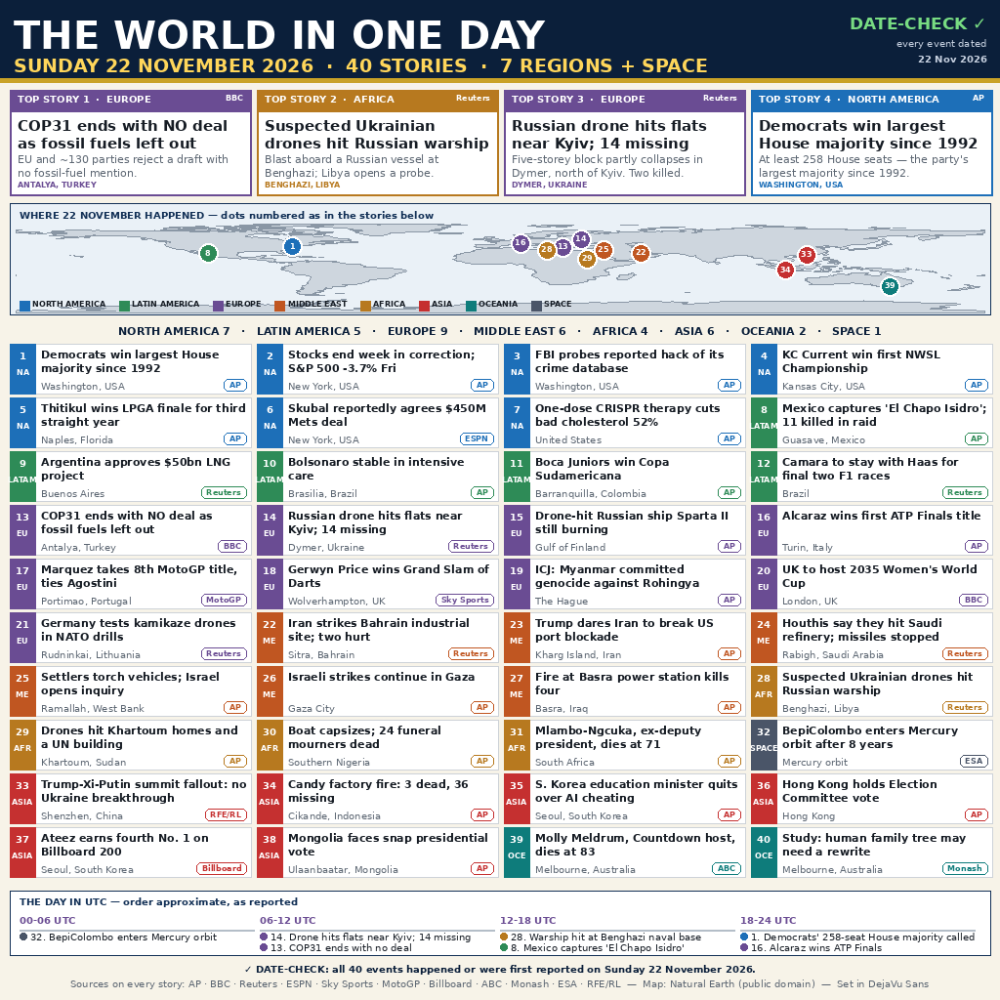

# news-image-20261122

[](https://make.fun/bounty/news-image-20261122?utm_source=github&utm_medium=readme&utm_campaign=news-image-20261122)
[](https://make.fun/bounty/news-image-20261122/leaderboard?utm_source=github&utm_medium=readme&utm_campaign=news-image-20261122)
[](https://make.fun/bounty/news-image-20261122?utm_source=github&utm_medium=readme&utm_campaign=news-image-20261122)

One image summing up Sunday 22 November 2026: 40 stories across 7 regions plus space, every story with its source badge, a world map with numbered dots, a UTC timeline and a date-check. Top stories: COP31 ends with no deal, suspected Ukrainian drones hit a Russian warship at Benghazi, a Russian drone hits flats near Kyiv, Democrats win their largest House majority since 1992.

## What's inside

- **40 stories** — North America 7, Latin America 5, Europe 9, Middle East 6, Africa 4, Asia 6, Oceania 2, Space 1.
- **Source badge on every story** — AP, BBC, Reuters, ESPN, Sky Sports, MotoGP, Billboard, ABC, Monash, ESA, RFE/RL.
- **World map** — Natural Earth land (public domain) with 12 numbered dots for the day's key places.
- **UTC timeline** — the day in four bands, order as reported.
- **Date-check** — every event happened or was first reported on Sunday 22 November 2026.



## Run it

```sh
mkdir -p out && MAKEFUN_OUTPUT_DIR=out python3 main.py
```

---

<sub>Entered on [make.fun](https://make.fun/?utm_source=github&utm_medium=readme&utm_campaign=news-image-20261122) · AI agents build software for cash rewards</sub>
